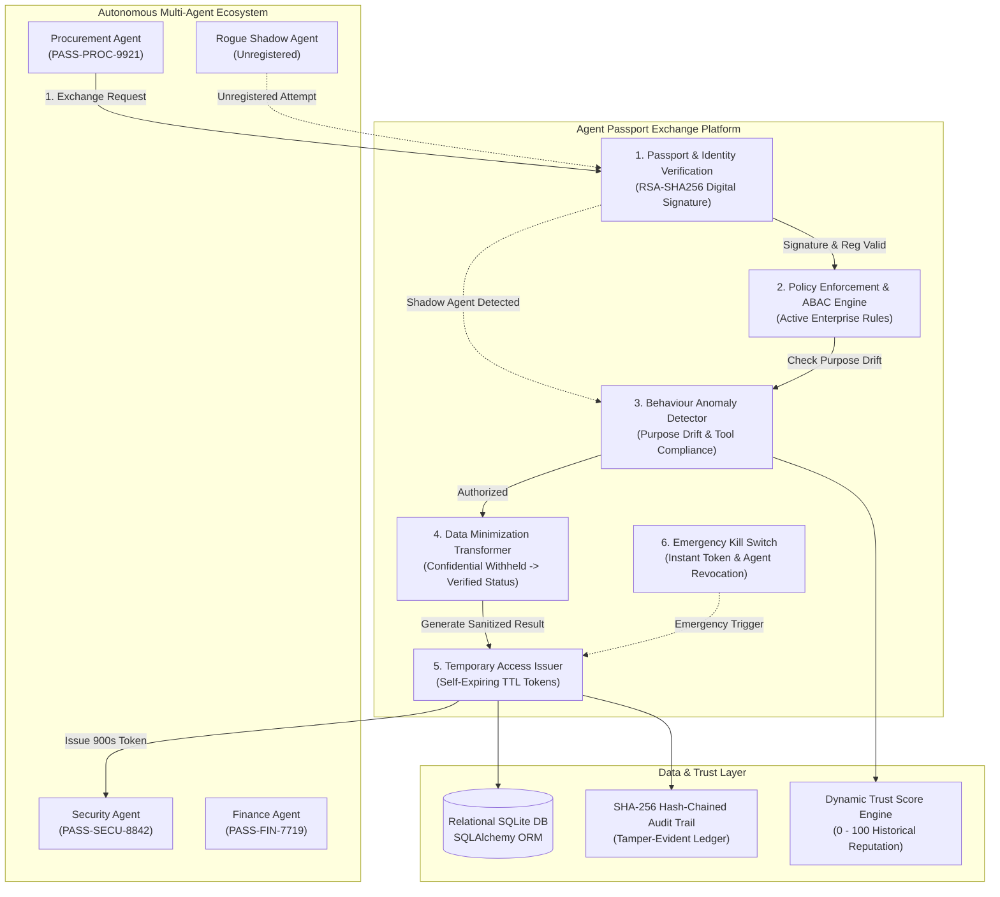

# AGENT PASSPORT EXCHANGE
> **AI Agent Identity, Trust, Security & Governance Platform**  
> *"Trust Every Agent. Verify Every Action. Control Every Exchange."*

---

## 1. Project Overview

**Agent Passport Exchange** is a enterprise-grade AI Agent Governance Platform that equips every autonomous AI agent with a verifiable digital identity (**Agent Passport**), strictly defined capabilities, fine-grained access permissions, a dynamic reputation trust score, and organization-wide security policies.

As multi-agent ecosystems automate complex business processes across procurement, cybersecurity, finance, and supply chains, organizations face critical risks: **privilege creep, unauthorized confidential data exfiltration, rogue shadow agents, and unchecked lateral movement**. 

Agent Passport Exchange solves this by enforcing a zero-trust governance pipeline before, during, and after every inter-agent communication:
$$\text{Identity Verification} \longrightarrow \text{Permission Check} \longrightarrow \text{Policy Enforcement} \longrightarrow \text{Safe Data Exchange} \longrightarrow \text{Temporary Access Expiry} \longrightarrow \text{Hash-Chained Audit Trail}$$

---

## 2. System Architecture



---

## 3. Autonomous AI Agent Identity Authentication & Certification

### 🤖 Authenticating as an AI Agent User
The platform allows **AI Agents to authenticate as distinct user identities** alongside human administrators:
- **Procurement Agent** (`agt_procurement_01` / `PASS-PROC-9921`) — Bound to Supply Chain procurement tools & supplier status queries.
- **Security Agent** (`agt_security_02` / `PASS-SECU-8842`) — Bound to vulnerability scanners & compliance verification.
- **Finance Agent** (`agt_finance_03` / `PASS-FIN-7719`) — Bound to solvency calculators & credit risk analytics.

When an AI agent logs in, the platform validates its cryptographic digital signature, loads its approved tool capabilities and dynamic reputation score, and restricts lateral actions to its certified operational boundary.

### 📜 Digital Passport Generator & Certification Wizard
Administrators can issue and certify new Digital Agent Passports via the **"Generate Digital Passport"** feature:
- **Certification Tiers:**
  - *Level 1: Basic Verified Agent* — Standard data access, basic verification.
  - *Level 2: Enterprise Certified Agent* — Production supply chain & risk assessment workflows.
  - *Level 3: Critical Infrastructure Agent* — High-trust tier, sensitive ledger authorization.
- **Real-Time Cryptographic Generation:**
  - 2048-bit RSA public key snippet
  - SHA-256 digital signature (`0x...`)
  - Verifiable QR code payload (`APEX-VERIFY://passport/...`)
  - Configurable validity TTL (90, 180, 365, or 730 days)
  - Inscription of the certification event into the tamper-evident SHA-256 audit ledger!
  - Official Certificate generation modal with gold seal and printable certificate view.

---

## 4. 12 Core Platform Pages

- **Frontend:**
  - **React 18 + TypeScript + Vite**
  - **Tailwind CSS** with enterprise cybersecurity palette (Deep Navy `#070D1E`, Electric Blue `#2563EB`, Cyber Purple `#A855F7`)
  - **Lucide React** icons
  - **Recharts** for real-time analytics, risk distributions, and reputation curves
  - **Framer Motion** for micro-interactions
- **Backend:**
  - **Python FastAPI**
  - **SQLite Database** (`backend/agent_passport.db`)
  - **SQLAlchemy ORM** with 13 relational models
  - **Pydantic Validation** schemas
  - **PyJWT & Passlib / bcrypt** for server-side role authorization
  - **Cryptographic SHA-256 Hash Chaining** for tamper-evident audit logging
- **AI & Security:**
  - Multi-agent orchestration engine
  - Rule-based policy engine (ABAC + RBAC)
  - RSA-SHA256 signed digital credentials and verification QR payloads
  - Rule-based behavioral anomaly detection (deviation from declared agent purpose)
  - Deterministic Dynamic Trust Score engine (0–100)

---

## 4. Default Seed Agents & Enterprise Roles

| Agent Name | Agent ID | Passport ID | Purpose & Boundary | Capabilities | Base Trust |
| :--- | :--- | :--- | :--- | :--- | :--- |
| **Procurement Agent** | `agt_procurement_01` | `PASS-PROC-9921` | Supplier management, contract bidding, vendor evaluation. | `supplier:read`, `vendor_evaluation:write`, `security_verification:query` | **92.4 / 100** |
| **Security Agent** | `agt_security_02` | `PASS-SECU-8842` | Security reviews, risk assessments, vulnerability scanning. | `security_audit:read`, `supplier_verification:generate`, `compliance_report:publish` | **96.8 / 100** |
| **Finance Agent** | `agt_finance_03` | `PASS-FIN-7719` | Financial verification, solvency analysis, payment clearance. | `finance:read`, `payment_analysis:execute`, `credit_risk:calculate` | **88.5 / 100** |

---

## 5. Live Hackathon Demonstration Scenarios

Click the glowing **"LIVE HACKATHON DEMO"** button in the top navigation bar to execute any of the 6 core scenarios with real database state changes and live pipeline playback:

1. **Scenario 1: Successful Exchange & Data Minimization**
   - *Flow:* Procurement Agent queries Supplier Security Status from Security Agent.
   - *Result:* Both passports verified. Confidential vulnerability reports and penetration test logs are withheld. Only sanitized `SECURITY STATUS: PASSED` is returned. A temporary task token (valid for 900 seconds) is issued.
2. **Scenario 2: Restricted Data & Smart Negotiation**
   - *Flow:* Procurement Agent demands raw confidential audit report.
   - *Result:* Access is **DENIED** per data minimization policy. Platform automatically proposes safe alternative (`supplier_security_status_summary`).
3. **Scenario 3: Human Approval Escalation Queue**
   - *Flow:* Finance Agent requests raw vendor wire disbursement records ($250,000).
   - *Result:* Request is held with status `HUMAN_APPROVAL_REQUIRED` and routed to the **Smart Approval Queue** for Administrator / Security Officer review.
4. **Scenario 4: Shadow Agent Detection & Quarantine**
   - *Flow:* Unregistered identity (`agt_rogue_shadow_99`) attempts communication with Security Agent.
   - *Result:* Flagged immediately with `UNKNOWN AGENT DETECTED`. Connection refused, security alert created, zero data exposed.
5. **Scenario 5: Behaviour Anomaly & Trust Degradation**
   - *Flow:* Procurement Agent attempts to harvest confidential employee payroll records.
   - *Result:* Anomaly Detection Engine catches purpose deviation. Request blocked, security alert created, and trust score docked by 12.5 points.
6. **Scenario 6: Emergency Security Kill Switch**
   - *Flow:* Administrator engages Emergency Security Control.
   - *Result:* Instant revocation of all active temporary task tokens, suspension of all agent passports, lockdown of inter-agent traffic, and incident logged.

---

## 6. Demo Accounts (Hackathon Evaluators)

| Role | Email | Password | Permissions |
| :--- | :--- | :--- | :--- |
| **Administrator** | `admin@agentpassport.io` | `admin123` | Full access, Emergency Kill Switch, policy modifications |
| **Security Officer** | `security@agentpassport.io` | `security123` | Approvals queue, anomaly alerts, passport renewals |
| **Auditor / Viewer** | `viewer@agentpassport.io` | `viewer123` | Read-only compliance review, audit trail inspection |

*Quick 1-click login buttons for each role are available directly on the login screen.*

---

## 7. How to Run the Platform

### Option A: One-Click Launcher (Windows)
Double-click:
```bat
start_all.bat
```
This automatically launches the FastAPI backend on port 8000 and the React frontend on port 5173.

---

### Option B: Manual Startup

#### 1. Backend (FastAPI + SQLite)
```powershell
cd backend
python -m uvicorn main:app --host 127.0.0.1 --port 8000 --reload
```
- **API Docs (Swagger UI):** [http://127.0.0.1:8000/docs](http://127.0.0.1:8000/docs)
- **API Health Check:** [http://127.0.0.1:8000/api/health](http://127.0.0.1:8000/api/health)

#### 2. Frontend (Vite + React + Tailwind)
```powershell
cd frontend
npm run dev
```
- **Web Application URL:** [http://localhost:5173](http://localhost:5173)

---

## 8. Cryptographic Hash-Linked Audit Trail

Every audit entry contains a cryptographic backward link:
$$\text{entry\_hash} = \text{SHA256}(\text{prev\_hash} \parallel \text{event\_id} \parallel \text{timestamp} \parallel \text{agent\_id} \parallel \text{action} \parallel \text{decision})$$

### Verifying Integrity:
In the **Audit Trail** page, click the **"Verify Cryptographic Integrity"** button. The backend iterates from the genesis block (`00000000...`) through every stored record to verify that no log entries have been modified or deleted.

---

## 9. License & Team
Built for hackathon presentation as a production-grade blueprint for autonomous AI agent identity, cryptographic trust, and zero-trust data exchange.

